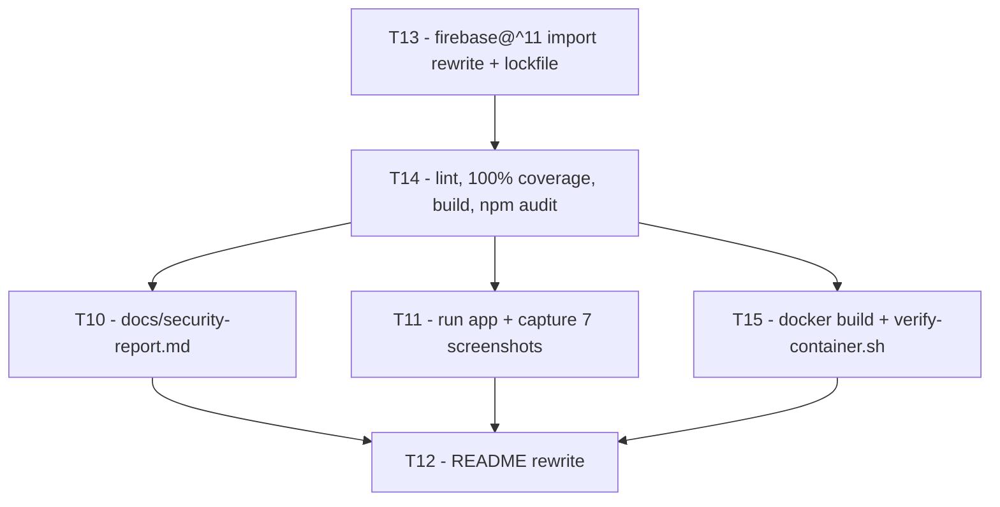

# React Burger Builder — Completion Plan (T10–T12 + build fix)

> Supersedes plan `b1de25e5-7d14-4e16-8fcf-e2b94e837185` (revision 1), whose T1–T9 are already implemented in this tree. This plan carries the same task identities forward: **T10, T11, T12** are the original tasks, **T13–T15** are new tasks added by the verification pass.

## Where the plan stands

T1–T9 are implemented and verified in the working tree:

| Task | Status | Evidence in the tree |
|---|---|---|
| T1 runtime + ignores | done | `.nvmrc` = `18`; `engines` in `package.json`; `.gitignore` covers `node_modules/`, `build/`, `coverage/`, `.env.local`, `.DS_Store`, logs |
| T2 toolchain | done | `react-scripts@5.0.1`, React `^18.3.1`; lockfileVersion 3; ejected `config/` internals gone; no `enzyme`/`axios` in the tree |
| T3 React 18 runtime | done | `src/index.js` uses `createRoot` + `StrictMode` and a guarded DevTools compose; `src/App.js` uses `React.lazy`/`Suspense` with a `<Spinner />` fallback |
| T4 Firebase SDK | done | `src/services/firebase.js`; zero `axios`, zero `AIza` keys in `src/`, zero `?auth=` token in any URL; `withErrorHandler`/`asyncComponent` deleted; `ErrorModal` replaces the interceptor |
| T5 env + rules | done | `.env`, `.env.example`, `firebase.database.rules.json` referenced from `firebase.json` `database.rules` |
| T6 RTL harness | done | `src/setupTests.js` with the `crypto.getRandomValues` polyfill; `resetMocks: false`; jest config in `package.json` |
| T7 100% coverage | done | committed `coverage/lcov-report/index.html` → 482/482 statements, 173/173 branches, 166/166 functions, 474/474 lines |
| T8 Docker | done | `Dockerfile` (`node:18-alpine` → `nginxinc/nginx-unprivileged:1.25-alpine`, port 8080, `/healthz`), `docker/nginx.conf` with CSP + HSTS, `docker-compose.yml`, `.dockerignore` |
| T9 CI | done | `.github/workflows/ci.yml` (lint-test-build, audit, docker, security jobs) and `.github/dependabot.yml` |

Remaining: **T10, T11, T12** — plus one blocker found while verifying T8.

## Blocker: the production build fails

`build/` contains only `favicon.ico` and `manifest.json` — no `index.html`, no `static/`, no `asset-manifest.json`. CRA 5's `copyPublicFolder()` runs before webpack, so the bundle never landed. This gates T8's acceptance, T11's container-parity flow and T12.

Root cause: the installed Firebase packages are bleeding-edge scoped releases — `@firebase/app@0.16.6`, `@firebase/auth@1.13.10`, `@firebase/database@1.1.6` — whose `engines` declare `node >= 24.12.0`. Their dist syntax targets a runtime far newer than this project and is not parseable by CRA 5's Babel. They also contradict the original plan, which specifies `firebase@^11`.

**Decision (locked):** align to the `firebase@^11` umbrella package and keep Node 18. `firebase@11.x` declares `node >= 18` and its dists are CRA 5-compatible.

### T13 — Align the Firebase SDK to firebase@^11 and restore the build

`package.json`
- Remove `@firebase/app`, `@firebase/auth`, `@firebase/database` from `dependencies`; add `"firebase": "^11.0.2"`.
- Keep `engines.node` at `>=18 <21`; `.nvmrc` stays `18`; Docker builder stays `node:18-alpine`; CI `NODE_VERSION` stays `'18'`.

Import path changes — `@firebase/*` → `firebase/*` across 15 files:

| File | Change |
|---|---|
| `src/services/firebase.js` | `firebase/app`, `firebase/auth`, `firebase/database` |
| `src/store/actions/auth.js` | `firebase/auth` |
| `src/store/actions/burgerBuilder.js` | `firebase/database` |
| `src/store/actions/order.js` | `firebase/database` |
| `src/services/firebase.test.js` | imports + the three `jest.mock` targets |
| `src/store/actions/auth.test.js` | import + `jest.mock` |
| `src/store/actions/auth.unconfigured.test.js` | import + `jest.mock` |
| `src/store/actions/burgerBuilder.test.js` | import + `jest.mock` |
| `src/store/actions/burgerBuilder.unconfigured.test.js` | import + `jest.mock` |
| `src/store/actions/order.test.js` | import + `jest.mock` |
| `src/store/actions/order.unconfigured.test.js` | import + `jest.mock` |
| `src/App.test.js`, `src/App.lazy.test.js`, `src/App.lifecycle.test.js`, `src/index.test.js` | `jest.mock` targets only |

The API surface is identical between the scoped packages and `firebase@^11` (`initializeApp`, `getAuth`, `getDatabase`, `createUserWithEmailAndPassword`, `signInWithEmailAndPassword`, `signOut`, `onAuthStateChanged`, `ref`, `get`, `push`, `query`, `orderByChild`, `equalTo`), so no logic changes are needed — only the specifiers and the mock targets.

Also:
- Regenerate `package-lock.json` (`npm install`) so it stays lockfileVersion 3 and in sync for `npm ci` in CI and Docker.
- Merge remote ingredient counts over the local defaults so a partial `ingredients` node cannot produce `NaN` prices: in `src/store/actions/burgerBuilder.js`, dispatch `setIngredients({ ...DEFAULT_INGREDIENTS, ...value })`. One line, no new branch, so the 100% threshold is unaffected.

Acceptance: `npm run build` exits 0 and `build/` contains `index.html`, `asset-manifest.json` and `static/js/*.js`.

### T14 — Re-run the non-UI gates

In order; each must pass before the browser pass:
1. `npm run lint` → 0 errors.
2. `npm run test:coverage` → 100% statements / branches / functions / lines, exit 0.
3. `npm run build` → success (from T13).
4. `npm audit --audit-level=high` → exit 0. This output is pasted into T10.

Any failure blocks the rest and is fixed first.

### T15 — Rebuild and verify the Docker image

- `docker build -t burger-builder .` succeeds.
- Run the container and execute `sh scripts/verify-container.sh 8090 burger-test`, which asserts: `/healthz` → 200; `/` serves the built `index.html`; a hashed `/static/js/*.js` asset → 200; the five security headers are present; `/orders` falls back to the SPA shell; `/.env` is denied.
- The container is stopped afterwards.

### T10 — Security report (`docs/security-report.md`)

Structure:
1. **Scope and method** — dependency audit (`npm audit --audit-level=high` and `npm audit --json`) plus a source review of `src/`; what is in and out of scope.
2. **Dependency findings** — table: package | version before | advisory class | version after | status. Populated from the real audit run, not from memory.
3. **Application findings** — the catalogue carried over from the original plan, each marked fixed or accepted with the file that carries the fix:
   - hardcoded Firebase API key → `REACT_APP_FIREBASE_API_KEY` + database rules + documented API-key restrictions
   - ID token in the request URL (`?auth=…`) → the Firebase SDK signs requests; no token appears in any URL
   - legacy `identitytoolkit/v3` REST endpoints → `firebase/auth`
   - open demo database rules → `firebase.database.rules.json` scoping orders to `auth.uid`
   - axios interceptor swallowing rejections → HOC removed; per-slice errors surfaced in `ErrorModal`
   - `catch(err => err.response.data.error)` throwing `TypeError` on network errors → normalised error extraction
   - deprecated `componentWillMount` in the error HOC → HOC removed
   - vulnerable transitive chain (`sw-precache → request/shelljs`, `webpack` < 5.61, `webpack-dev-server` 2.x, `postcss` 6/7, `axios` 0.16, `redux` 3.7, `react-router-dom` 4.2, `react` 16.0, `minimatch`/`node-fetch`) → replaced by `react-scripts` 5 / React 18 / React Router 5.3.4 / Redux 4.2.1 / Firebase SDK 11
   - `removeIngredient` adding the ingredient price instead of subtracting it → corrected
   - no security headers on the served app → set in `docker/nginx.conf` and in `firebase.json` hosting headers
   - service worker precaching a stale bundle → service worker registration removed
4. **Residual risks** — the demo Firebase project may be unavailable; a Firebase web config is public by design and is constrained only by API-key restrictions plus database rules, which are console-side configuration; `.env` ships the demo project's public config; the CI image push trusts `GITHUB_TOKEN`.
5. **Post-fix re-scan** — the `npm audit` output pasted verbatim after the T13/T14 changes.

Acceptance: the file exists with all five sections, the before/after dependency table, and the real post-fix audit output.

### T11 — Run the app and capture UI screenshots

**Prerequisites supplied by you**, in the git-ignored `.env.local` (the committed `.env` keeps the public demo project as the default):
- the six `REACT_APP_FIREBASE_*` values for your project,
- Email/Password sign-in enabled in your project's Firebase Authentication,
- your Realtime Database rules deployed (`firebase deploy --only database` with `firebase.database.rules.json`, or equivalents that let a signed-in user read and write their own orders),
- an `ingredients` node holding the four keys `{salad, bacon, cheese, meat}` — optional; if absent the app falls back to local defaults and the builder still renders.

**Capture procedure** — dev server on port 3000 and the production container on 8080; drive the app with the browser tool at 1280×800 (480×800 for the mobile shot), PNG, no personal data in frame. A throwaway account is created on your project to reach the authenticated screens.

| File | Content |
|---|---|
| `docs/screenshots/01-burger-builder.png` | builder with ingredients added, price updated, ORDER NOW enabled |
| `docs/screenshots/02-build-controls.png` | control panel close-up |
| `docs/screenshots/03-auth.png` | sign-up / sign-in form |
| `docs/screenshots/04-checkout.png` | checkout summary modal |
| `docs/screenshots/05-contact-data.png` | contact form |
| `docs/screenshots/06-orders.png` | orders list |
| `docs/screenshots/07-mobile-drawer.png` | 480px viewport with the side drawer open |

The same session drives the plan's verification flows:
1. **builder** — add meat and cheese, the stack and price update, "Less" decrements back;
2. **auth** — `/auth` renders the form, an invalid email is flagged after touching the field, switching to SIGNIN relabels the submit button;
3. **unauthenticated order** — the button reads "SIGN UP TO ORDER" and routes to `/auth`;
4. **checkout** — ORDER NOW opens the summary modal, CONTINUE moves to `/checkout/contact-data`;
5. **contact data** — all six fields render, ORDER stays disabled until the form is valid, a valid submit dispatches the order;
6. **orders** — `/orders` lists the user's orders;
7. **responsive drawer** — at 480px the hamburger opens the drawer and closes on selection;
8. **container parity** — the image serves the same builder flow on 8080 and `/healthz` returns 200.

Acceptance: every PNG exists and is referenced from the README; each flow above has a recorded pass or fail.

### T12 — Rewrite the README

Replace the 2165-line CRA boilerplate with a project-specific document, in this order:

1. Title, CI and license badges, one-paragraph overview.
2. **Screenshots** — the seven T11 images with captions.
3. Features.
4. Tech stack table.
5. Prerequisites — Node 18 via `nvm` (this project's "virtual env"), npm 9+.
6. Quick start — `nvm use && npm ci && npm start`.
7. Environment variables table — the six `REACT_APP_FIREBASE_*` keys, default, purpose.
8. Scripts table — `start`, `build`, `test`, `test:coverage`, `lint`, `eject`.
9. Testing and coverage — how to run, the 100% threshold, `coverage/lcov-report/index.html`.
10. Security — link `docs/security-report.md`, the database rules summary, `firebase deploy --only database`, how to report a vulnerability.
11. Docker — build, run, compose, port 8080, healthcheck.
12. CI/CD — the four workflow jobs and what each one gates.
13. Project structure tree.
14. Deployment — Firebase Hosting and the nginx option.
15. Known limitations — demo project availability, the local default-ingredients fallback, auth needing a reachable Firebase project.
16. License.

Acceptance: every command in the README exists in `package.json`; all screenshot links resolve; no CRA boilerplate remains.

## Execution order

T13 → T14 → (T15, T10, T11) → T12.

## Risks and mitigations

| Risk | Mitigation |
|---|---|
| `firebase@^11` dists still upset CRA 5's Babel | Capture the exact webpack error before changing approach; `firebase@10.x` is the next fallback and is also CRA 5-compatible |
| Your Firebase project rejects email/password signups | Enable the provider in the Firebase console; the unauthenticated path in flow 3 is verifiable regardless |
| The `ingredients` node is missing or partial | The app falls back to `DEFAULT_INGREDIENTS`; T13 also merges defaults under remote values so a partial node cannot produce `NaN` |
| The npm registry is unreachable during the dependency swap | `node_modules` is already populated; the swap needs the registry for `firebase@^11` only |

## Verification

**Browser flows** — the app is started, every flow is exercised in the browser, and the screenshots in T11 are captured from these exact flows:

1. **Burger builder** — the app loads at `/`, adding a meat and a cheese ingredient updates the visual stack and the price, and the "Less" control decrements the price back down.
2. **Authentication** — `/auth` renders the email and password form, an invalid email is flagged invalid after touching the field, and switching to SIGNIN relabels the submit button.
3. **Unauthenticated order attempt** — with no session, the order button reads "SIGN UP TO ORDER" and routes to `/auth` instead of opening the order summary.
4. **Checkout** — an authenticated session reaching "ORDER NOW" opens the order summary modal with the ingredient list and total; CONTINUE moves to `/checkout/contact-data`.
5. **Contact data** — the contact form renders all six fields, the ORDER button stays disabled until the form is valid, and a valid submission dispatches the order.
6. **Orders** — `/orders` lists the user's orders with ingredients and price.
7. **Responsive drawer** — at a 480px viewport, the hamburger opens the side drawer and closes on selection.
8. **Container parity** — the Docker image serves the same builder flow on port 8080, and `curl /healthz` returns 200.

Before the browser pass, the non-UI gates must be green: `npm run lint` (0 errors), `npm run test:coverage` (100% across all four metrics, exit 0), `npm run build` (success), `npm audit --audit-level=high` (exit 0), and `docker build` (success). Any gate that fails blocks the browser pass and is fixed first.
