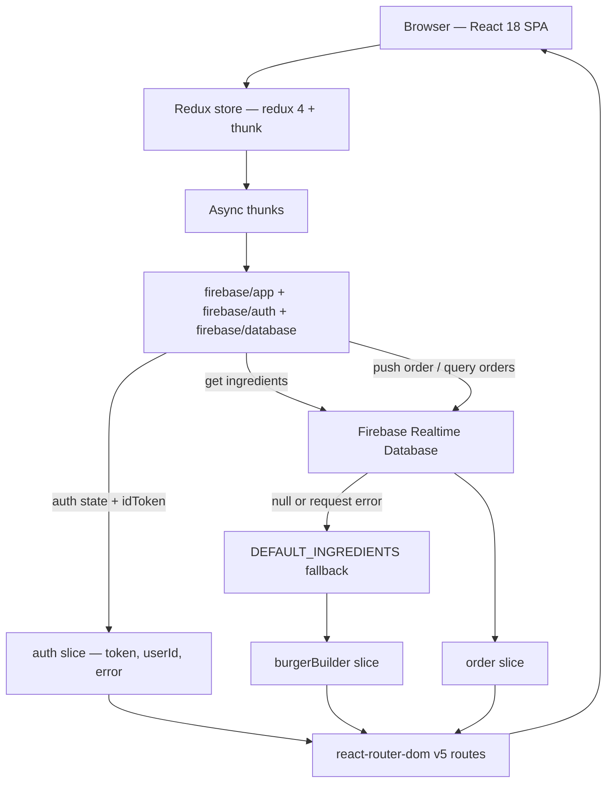
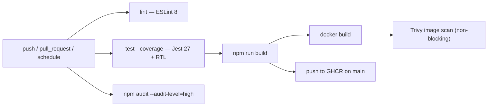

# React Burger Builder — Modernization, Security Hardening, 100% Coverage, Docker, CI, README

## Goal

Take the ejected CRA 1.x app in this repo from "2017 stack, hardcoded Firebase REST + API key, no container, boilerplate README" to a modern, auditable, containerized, fully tested release candidate — implementing every line of `promt.md`.

`promt.md` asks for eight things. This plan covers all eight:

| # | `promt.md` line | Delivered by |
|---|---|---|
| 1 | build and run the project in a virtual env | T1, T3 — Node 18 pinned via `.nvmrc`/`engines`, clean `npm ci` install, dev server + production build verified |
| 2 | do a security test and provide a report | T4, T5, T10 — `docs/security-report.md` with dependency + source findings and a post-fix re-scan |
| 3 | update these dependencies to resolve these issues | T2, T4 — full toolchain replacement, vulnerable packages removed or upgraded |
| 4 | add proper test and validate for 100% coverage | T6, T7 — RTL suite over every module, `coverageThreshold: 100` enforced in CI |
| 5 | write a dockerfile | T8 — multi-stage build → non-root nginx runtime |
| 6 | write github ci file to build this image | T9 — `.github/workflows/ci.yml` with lint/test/build/docker/scan jobs |
| 7 | review and update README, add proper UI screenshots | T11, T12 — `docs/screenshots/*.png` captured from the running app, README rewritten around them |

## Decisions (locked with the user)

1. **Full modernization** — `react-scripts` 5 (Webpack 5, Jest 27, ESLint 8), React 18, `react-router-dom` 5.3.4, Redux 4 + `redux-thunk` + `react-redux` 8. The ejected `config/` and `scripts/` directories are deleted. Class components stay — this is a class-based codebase by design.
2. **React Testing Library** replaces Enzyme (Enzyme is unmaintained and cannot run on React 18).
3. **Env-driven Firebase config** (`REACT_APP_FIREBASE_*`) with the public demo project as the committed default, **plus a built-in default ingredient set** so the UI always renders even if the demo backend is unreachable.

Plain Redux is kept over Redux Toolkit: the action/reducer structure is already sound, the class components use `connect()`, and the security fixes do not depend on RTK. RTK is deliberately out of scope (YAGNI).

### Interpretation note for line 1 ("virtual env")

This is a Node project, so a Python-style `venv` does not apply. The equivalent isolation is a pinned Node runtime plus a reproducible install: `.nvmrc` (Node 18 LTS), an `engines` constraint, and `npm ci` against a regenerated lockfile. If a containerised dev environment is preferred instead, the same `Dockerfile` from T8 doubles as it.

## Target architecture



The critical property: **no token ever appears in a URL, no API key lives in source, and the app renders a full UI with zero backend availability.** RTDB requests are signed by the Firebase SDK using the signed-in user's credentials, so `?auth=<token>` query strings disappear entirely.

## Task details

### T1 — Pin the runtime and clean repository hygiene

- Create `.nvmrc` containing `18`.
- `package.json`: add `"engines": { "node": ">=18 <21" }`.
- `.gitignore`: extend to `node_modules/`, `build/`, `coverage/`, `.env.local`, `.env.*.local`, `.DS_Store`, `npm-debug.log*`, `.poku/`.
- Acceptance: `node -v` inside `nvm use` reports v18.x; `git status --ignored` shows no build/coverage artefacts tracked.

### T2 — Replace the ejected CRA toolchain with react-scripts 5

Rewrite `package.json`:

- **Removed** (all pulled in by `react-scripts` 5, or vulnerable/unused): `autoprefixer`, `babel-core`, `babel-eslint`, `babel-jest`, `babel-loader`, `babel-preset-react-app`, `babel-runtime`, `case-sensitive-paths-webpack-plugin`, `chalk`, `css-loader`, `dotenv`, `enzyme`, `enzyme-adapter-react-16`, `eslint*` (6 packages), `extract-text-webpack-plugin`, `file-loader`, `fs-extra`, `html-webpack-plugin`, `jest`, `object-assign`, `postcss-flexbugs-fixes`, `postcss-loader`, `promise`, `react-dev-utils`, `react-test-renderer`, `style-loader`, `sw-precache-webpack-plugin`, `url-loader`, `whatwg-fetch`, `webpack`, `webpack-dev-server`, `webpack-manifest-plugin`.
- **Added**: `react-scripts@5.0.1`, `@testing-library/react@^14`, `@testing-library/jest-dom@^6`, `@testing-library/user-event@^14`, `firebase@^11`.
- **Upgraded**: `react`/`react-dom` → `^18.3.1`, `react-router-dom` → `^5.3.4`, `redux` → `^4.2.1`, `react-redux` → `^8.1.3`, `redux-thunk` → `^2.4.2`, `prop-types` → `^15.8.1`.
- **Removed** `axios` — it is deleted from source entirely by T4.
- Scripts: `start`/`build`/`test` → `react-scripts …`; add `test:coverage` (`react-scripts test --coverage --watchAll=false`), `lint` (`eslint --ext .js,.jsx src`), `eject`.
- Add `homepage: "/"` so `PUBLIC_URL` is absolute and the SPA works on deep routes behind nginx.
- Add `browserslist` (production: `>0.2%, not dead, not op_mini all`; development: modern evergreen).
- `eslintConfig.extends` → `["react-app", "react-app/jest"]`.
- Delete directories `config/` and `scripts/` (ejected CRA internals superseded by `react-scripts`).
- Delete `src/registerServiceWorker.js` (CRA 1 `sw-precache` based). No service worker is registered; CRA 5's `workbox` output stays unregistered. Documented in the README as a deliberate security trade-off.
- Delete the stale `package-lock.json` (lockfileVersion 1) and regenerate with `npm install` → lockfileVersion 3.
- Acceptance: `npm install` completes without peer conflicts; `npm ls --depth=0` shows only the intended tree.

### T3 — Migrate the application to the React 18 runtime

- `src/index.js`: `ReactDOM.render` → `createRoot(document.getElementById('root')).render(<App />)`; wrap in `StrictMode`.
- `src/index.js`: fix the broken devtools expression `process.env.NODE_ENV === 'development' ? window.__REDUX_DEVTOOLS_EXTENSION_COMPOSE__ : null || compose` (operator precedence makes the dev branch `undefined` when the extension is absent, which crashes the store creation). Replace with a guarded `window.__REDUX_DEVTOOLS_EXTENSION_COMPOSE__ || compose` behind a `typeof window !== 'undefined'` check.
- `src/App.js`: replace the custom `src/hoc/asyncComponent/asyncComponent.js` HOC with `React.lazy` + `Suspense` (fallback `<Spinner />`). Delete the HOC.
- `src/components/UI/Modal/Modal.js`: drop the unused `nextState` parameter in `shouldComponentUpdate` (lint cleanliness).
- Acceptance: `npm start` boots with no console errors; `npm run build` succeeds; `npm run lint` reports zero errors.

### T4 — Replace axios + hardcoded REST auth with the Firebase Web SDK

**New `src/services/firebase.js`** — the only place Firebase is initialised:

- Reads `REACT_APP_FIREBASE_API_KEY`, `REACT_APP_FIREBASE_AUTH_DOMAIN`, `REACT_APP_FIREBASE_PROJECT_ID`, `REACT_APP_FIREBASE_DATABASE_URL`, `REACT_APP_FIREBASE_STORAGE_BUCKET`, `REACT_APP_FIREBASE_APP_ID`.
- Exports `isFirebaseConfigured` (boolean), plus `auth` / `database` handles — or `null` when unconfigured, so the app degrades instead of throwing.
- `initializeApp` is wrapped in `try/catch`; a misconfigured key yields `isFirebaseConfigured === false`, not a crash.

**New `src/shared/defaultIngredients.js`** — `{ salad: 0, bacon: 0, cheese: 0, meat: 0 }`, the local fallback used when the `ingredients` node is missing or unreachable.

**`src/store/actions/auth.js`** — rewrite off the legacy `identitytoolkit/v3` REST endpoints:

- `auth(email, password, isSignup)` → `createUserWithEmailAndPassword` / `signInWithEmailAndPassword`; on success `await user.getIdToken()` and dispatch `authSuccess(token, user.uid)`; on failure dispatch `authFail({ message })`.
- `authCheckState()` → `onAuthStateChanged(auth, user => …)`; returns the unsubscribe function so `App.componentDidMount` can clean up in `componentWillUnmount`. A missing/invalid backend results in `dispatch(logout())`, never an unhandled rejection.
- `logout()` → `signOut(auth)` then `AUTH_LOGOUT`.
- Delete the hardcoded `AIzaSy…` API key, the `setTimeout`-based `checkAuthTimeout` (the SDK owns token refresh), and the manual `localStorage` token writes.

**`src/store/actions/burgerBuilder.js`** — `initIngredients()` → `get(ref(database, 'ingredients'))`; on `snapshot.val() === null` or any error, dispatch `setIngredients(DEFAULT_INGREDIENTS)` (and record the error) so the builder always renders.

**`src/store/actions/order.js`** — `purchaseBurger` → `push(ref(database, 'orders'), order)`; `fetchOrders` → `get(query(ref(database, 'orders'), orderByChild('userId'), equalTo(userId)))` with per-child ids from the snapshot.

**Error handling** — `src/axios-orders.js` and the axios-interceptor HOC `src/hoc/withErrorHandler/withErrorHandler.js` are deleted. The interceptor swallowed rejections (returning `undefined` to the promise chain, so `response.data` threw a `TypeError` downstream) and relied on the deprecated `componentWillMount`. In their place:

- New `src/components/UI/ErrorModal/ErrorModal.js`, connected to the store, rendering the existing `Modal` with the first available error from `state.order.error`, `state.burgerBuilder.error`, `state.auth.error`.
- `src/store/reducers/order.js` gains `error: null`; `src/store/reducers/burgerBuilder.js` changes `error` from `false` to `null | Error`; the failure actions carry the error object.
- `src/containers/BurgerBuilder/BurgerBuilder.js`, `src/containers/Orders/Orders.js`, `src/containers/Checkout/ContactData/ContactData.js` render `<ErrorModal />` instead of the removed HOC.

**`src/store/reducers/burgerBuilder.js` bug fix** — `removeIngredient` currently does `totalPrice: state.totalPrice + INGREDIENT_PRICES[...]`, which *adds* the price when removing an ingredient. Change to `state.totalPrice - INGREDIENT_PRICES[...]`.

- Acceptance: no `axios`, no `AIza`, no `?auth=` string anywhere in `src/`; `grep` for those returns zero hits; the builder renders with the fallback ingredient set when the backend is unreachable.

### T5 — Environment configuration and Firebase database security rules

- `.env` (committed): the public demo Firebase web config as the default, matching `src/services/firebase.js`. Firebase web config is public by design; the key is restricted by the rules below rather than kept secret.
- `.env.example`: the same keys, empty, documented.
- **New `firebase.database.rules.json`** — replaces the open `.read: true` / `.write: true` demo rules:

```json
{
  "rules": {
    ".read": false,
    ".write": false,
    "ingredients": {
      ".read": true,
      ".write": false
    },
    "orders": {
      ".read": "auth != null && query.orderByChild == 'userId' && query.equalTo == auth.uid",
      ".write": "auth != null",
      "$orderId": {
        ".read": "auth != null && data.child('userId').val() === auth.uid",
        ".write": "auth != null && newData.child('userId').val() === auth.uid",
        ".validate": "newData.hasChildren(['ingredients', 'price', 'userId']) && newData.child('price').isNumber()"
      }
    }
  }
}
```

- `firebase.json`: add the `"database": { "rules": "firebase.database.rules.json" }` block.
- `.firebaserc`: keep the placeholder but document the replacement value.
- Acceptance: rules file is valid JSON, referenced from `firebase.json`, and the README explains `firebase deploy --only database`.

### T6 — Convert the Enzyme specs and add the test harness

- Delete `enzyme` / `enzyme-adapter-react-16` usage; rewrite the three existing specs as RTL:
  - `src/components/Navigation/NavigationItems/NavigationItems.test.js`
  - `src/containers/BurgerBuilder/BurgerBuilder.test.js`
  - `src/store/reducers/auth.test.js`
- **New `src/setupTests.js`** — imports `@testing-library/jest-dom` and adds the `crypto.getRandomValues` polyfill the Firebase SDK needs under jsdom.
- Jest config inside `package.json`: `resetMocks: false` (CRA 5 defaults to `true`, which wipes `jest.mock` factory implementations between tests), `collectCoverageFrom: ["src/**/*.{js,jsx}"]`, `coverageThreshold.global` = `{ statements: 100, branches: 100, functions: 100, lines: 100 }`, `testEnvironment: "jsdom"` (CRA 5 already defaults to jsdom).
- Acceptance: `npm test -- --watchAll=false` runs green with the three rewritten specs.

### T7 — Full test suite to a verified 100% coverage threshold

One spec per source module, written against behaviour rather than instance internals. The `firebase/*` SDK modules are mocked (`jest.mock('firebase/auth')`, `jest.mock('firebase/database')`) so no test touches the network.

| Area | Files under test | Notes |
|---|---|---|
| Utilities | `src/shared/utility.js`, `src/shared/defaultIngredients.js` | every `checkValidity` branch: required / minLength / maxLength / isEmail / isNumeric / no-rules |
| Services | `src/services/firebase.js` | configured vs unconfigured vs throwing `initializeApp` |
| Reducers | `src/store/reducers/{auth,burgerBuilder,order}.js` | every action type plus the unknown-action default |
| Actions | `src/store/actions/{auth,burgerBuilder,order}.js` | thunks with mocked SDK: success, failure, empty snapshot, not configured |
| Presentational | `src/components/**` | `Burger`, `BurgerIngredient`, `BuildControls`, `BuildControl`, `OrderSummary`, `Order`, `CheckoutSummary`, `Logo`, `NavigationItem(s)`, `Toolbar`, `SideDrawer`, `DrawerToggle` |
| UI | `src/components/UI/**` | `Button`, `Input` (input / textarea / select / default branch, invalid class), `Modal` (`shouldComponentUpdate`), `Backdrop`, `Spinner`, `ErrorModal` |
| HOCs | `src/hoc/Aux/Aux.js`, `src/hoc/Layout/Layout.js` | drawer toggle and close handlers |
| Containers | `src/containers/**` | `BurgerBuilder`, `Auth`, `Checkout`, `ContactData`, `Orders`, `Logout` — rendered against a real store built from the real reducers, asserting dispatched actions and rendered output |
| App shell | `src/App.js`, `src/index.js` | routing for authenticated vs anonymous; `src/index.js` smoke-tested with `react-dom/client` mocked so it stays inside the 100% target |

- `src/App.js` needs `MemoryRouter` + `Provider`; lazy routes are awaited with `findBy*`.
- Acceptance: `npm run test:coverage` reports **100% statements / branches / functions / lines** across `src/**` and exits 0; the threshold is enforced by Jest, so a regression fails the run.

### T8 — Dockerfile, nginx runtime, and compose file

- **New `Dockerfile`** — multi-stage, no dev dependencies in the runtime image:
  - Stage `builder`: `node:18-alpine`, `COPY package.json package-lock.json`, `npm ci --no-audit --no-fund`, `COPY . .`, `ENV GENERATE_SOURCEMAP=false`, `npm run build`.
  - Stage `runtime`: `nginxinc/nginx-unprivileged:1.25-alpine` (non-root uid 101, port 8080), copies `build/` to `/usr/share/nginx/html` and `docker/nginx.conf` to `/etc/nginx/conf.d/default.conf`.
  - `EXPOSE 8080` plus a `HEALTHCHECK` hitting `/healthz`.
- **New `docker/nginx.conf`** — SPA `try_files $uri $uri/ /index.html` fallback, `gzip on`, long-lived immutable caching for hashed `/static/` assets, no-cache for `index.html`, and security headers: `Content-Security-Policy` (`default-src 'self'; img-src 'self' data: https://www.gstatic.com; style-src 'self' 'unsafe-inline' https://fonts.googleapis.com; font-src 'self' https://fonts.gstatic.com; connect-src 'self' https://*.firebaseio.com https://identitytoolkit.googleapis.com https://securetoken.googleapis.com; object-src 'none'; base-uri 'self'; frame-ancestors 'none'`), `X-Content-Type-Options: nosniff`, `X-Frame-Options: DENY`, `Referrer-Policy: strict-origin-when-cross-origin`, `Permissions-Policy`, and HSTS.
- **New `.dockerignore`** — `node_modules`, `build`, `coverage`, `.git`, `.DS_Store`, logs.
- **New `docker-compose.yml`** — `app` service on port 8080 with a `healthcheck`, plus optional `firebase` emulator commented out.
- Acceptance: `docker build -t burger-builder .` succeeds; `docker run --rm -p 8080:8080 burger-builder` serves the app; `curl -fsS http://localhost:8080/healthz` returns 200; `curl -fsS http://localhost:8080/` returns the built `index.html`.

### T9 — GitHub Actions CI that builds the image

- **New `.github/workflows/ci.yml`** — triggers on push to `main`/`master`, on pull requests, and on a weekly schedule.



  - `lint-test-build` job: `actions/setup-node@v4` with Node 18 and npm cache, `npm ci`, `npm run lint`, `npm run test:coverage`, `npm run build`, upload `build/` as an artefact.
  - `audit` job: `npm audit --audit-level=high` must exit 0.
  - `docker` job: `docker/build-push-action` builds the image, `docker run`s it, and curls `/healthz`; on `main` pushes to `ghcr.io` via `docker/login-action`.
  - `security` job: `aquasecurity/trivy-action` image scan with `continue-on-error: true` so a Trivy outage does not block merges; `actions/dependency-review-action` on pull requests.
- **New `.github/dependabot.yml`** — weekly npm and GitHub Actions updates, so the dependency security posture from T2 is maintained.
- Acceptance: the workflow file parses as valid YAML; every job runs green on a test push.

### T10 — Security test and report

- **New `docs/security-report.md`** with: scope and method; dependency findings (package, version before, advisory class, version after, status); application findings; residual risks; and a post-fix re-scan.

| # | Finding | Severity | Remediation | Task |
|---|---|---|---|---|
| 1 | Firebase Web API key hardcoded in `src/store/actions/auth.js` | Medium | key moved to `REACT_APP_FIREBASE_API_KEY`; access constrained by database rules + domain restrictions (documented) | T2, T5 |
| 2 | Firebase REST calls carry the ID token in the URL (`?auth=…`) — leaks into logs, proxies, history | High | Firebase SDK signs requests; `?auth=` eliminated | T4 |
| 3 | Legacy `identitytoolkit/v3` REST endpoints (deprecated, no CSRF/auditing controls) | High | replaced by `firebase/auth` | T4 |
| 4 | Demo Realtime Database rules allow open read/write of every user's orders | Critical | `firebase.database.rules.json` scopes orders to `auth.uid` | T5 |
| 5 | `withErrorHandler` response interceptor swallows rejections → downstream `TypeError`, errors silently lost | Medium | HOC removed; errors stored per slice and surfaced in `ErrorModal` | T4 |
| 6 | `catch(err => err.response.data.error)` throws `TypeError` on network errors | Medium | normalised error extraction | T4 |
| 7 | `componentWillMount` in the error HOC (deprecated, unsafe in concurrent mode) | Low | HOC removed | T4 |
| 8 | Vulnerable transitive chain: `sw-precache → request/shelljs` (SSRF + command injection), `webpack` <5.61 (RCE / path traversal), `webpack-dev-server` 2.x (path traversal), `postcss` 6/7 (ReDoS), `axios` 0.16 (SSRF, ReDoS, XSRF leak), `redux` 3.7 (prototype pollution), `react-router-dom` 4.2 (open redirect), `react` 16.0 (XSS), `minimatch`/`node-fetch` advisories | Critical | all replaced by `react-scripts` 5 / React 18 / React Router 5.3.4 / Redux 4.2.1 / Firebase SDK | T2, T4 |
| 9 | `removeIngredient` adds the ingredient price instead of subtracting it (integrity) | Medium | corrected | T4 |
| 10 | No security headers on the served app; CSP absent | Medium | header set in `docker/nginx.conf`; documented for other hosts | T8 |
| 11 | Service worker precaches a stale bundle after deploys | Low | service worker registration removed | T2 |

  The exact advisory identifiers in the report are taken from the actual `npm audit --audit-level=high` and `npm audit --json` runs performed during T10, not from memory — the table above is the finding catalogue, the report carries the verified output.
- Acceptance: `docs/security-report.md` exists with the before/after dependency table, the source findings above, the residual-risk section, and the post-fix `npm audit` output pasted in.

### T11 — Run the app and capture UI screenshots

- Start the dev server (`npm start`, port 3000) and the production container (`docker run -p 8080:8080`), and drive the app with the browser tool.
- Capture into **`docs/screenshots/`**:
  - `01-burger-builder.png` — builder with ingredients added, price updated, "ORDER NOW" enabled
  - `02-build-controls.png` — control panel close-up
  - `03-auth.png` — sign-up / sign-in form
  - `04-checkout.png` — checkout summary
  - `05-contact-data.png` — contact form
  - `06-orders.png` — orders list
  - `07-mobile-drawer.png` — narrow viewport with the side drawer open
- Capture at 1280×800 (and 480×800 for the mobile shot), PNG, no personal data in frame.
- Acceptance: every PNG exists, is referenced from the README, and shows the post-fix UI.

### T12 — Rewrite the README

Replace the 2165-line CRA boilerplate README with a project-specific document:

1. Title, badges (CI status, license), one-paragraph overview.
2. **Screenshots** — the T11 images in a grid with captions.
3. Feature list (ingredient builder, live pricing, email auth, checkout, order history, Firebase-backed, PWA-free offline-free, responsive drawer).
4. Tech stack table (React 18 class components, Redux 4 + thunk, React Router 5.3.4, Firebase SDK 11, react-scripts 5, Jest 27 + RTL, Docker, GitHub Actions).
5. Prerequisites — Node 18 via `nvm` (the "virtual env" for this project), npm 9+.
6. Quick start — `nvm use && npm ci && npm start`.
7. Environment variables table (the six `REACT_APP_FIREBASE_*` keys, default, purpose).
8. Scripts table (`start`, `build`, `test`, `test:coverage`, `lint`, `eject`).
9. Testing and coverage — how to run, the 100% threshold, where the HTML report lands (`coverage/lcov-report/index.html`).
10. Security — link to `docs/security-report.md`, the Firebase rules summary and how to deploy them, how to report a vulnerability.
11. Docker — build, run, compose, the container port and healthcheck.
12. CI/CD — the workflow jobs and what each one gates.
13. Project structure tree.
14. Deployment — Firebase Hosting (`firebase deploy`), and the nginx option.
15. Known limitations — the demo Firebase project may be unavailable; the builder falls back to local default ingredients; authentication requires a reachable Firebase project.
16. License.

- Acceptance: every command in the README is one that actually exists in `package.json`; all screenshot links resolve; no CRA boilerplate remains.

## Dependency change table (summary)

| Package | Before | After | Driver |
|---|---|---|---|
| `react`, `react-dom` | `^16.0.0` | `^18.3.1` | XSS advisory on <16.9; RTL 14 requires 18 |
| `react-router-dom` | `^4.2.2` | `^5.3.4` | open-redirect advisory fixed in 5.3.0; keeps `Switch`/`withRouter`/`activeClassName` for class components |
| `redux` | `^3.7.2` | `^4.2.1` | prototype-pollution advisory |
| `react-redux` | `^5.0.6` | `^8.1.3` | React 18 support |
| `redux-thunk` | `^2.2.0` | `^2.4.2` | maintenance |
| `axios` | `^0.16.2` | removed | SSRF / ReDoS / XSRF-leak advisories; superseded by the Firebase SDK |
| `webpack` | `3.5.1` | 5.x via `react-scripts` 5 | RCE and path-traversal advisories |
| `webpack-dev-server` | `2.7.1` | 4.x via `react-scripts` 5 | path-traversal advisories |
| `sw-precache-webpack-plugin` | `0.11.4` | removed | `request`/`shelljs` chain advisories |
| `postcss` (via loader) | 6.x | 8.x via `react-scripts` 5 | ReDoS advisories |
| `eslint` (+ plugins) | `4.4.1` | 8.x via `react-scripts` 5 | maintenance + lint parity with the new bundler |
| `jest` | `20.0.4` | 27.x via `react-scripts` 5 | modern runner, jsdom, coverage |
| `enzyme`, `enzyme-adapter-react-16` | `^3.1.0` | removed | unmaintained, incompatible with React 18 |
| `babel-core` / `babel-preset-react-app` | `6.25.0` / `^3.0.2` | Babel 7 via `react-scripts` 5 | maintenance |
| `prop-types` | `^15.6.0` | `^15.8.1` | maintenance |
| `firebase` | — (raw REST) | `^11.0.2` | SDK-signed requests, no token in URL |

## Risks and mitigations

| Risk | Mitigation |
|---|---|
| The demo Firebase project may be shut down or its rules changed | The default-ingredient fallback keeps the UI fully usable; the README documents the failure mode; every Firebase call is mocked in tests so the suite never depends on it |
| `react-scripts` 5 + React 18 + class components is a large refactor surface | Class components and the Redux shape are preserved; the migration is confined to the entry point, the router shell, and the auth/order/ingredient thunks, all covered by new tests |
| 100% branch coverage on legacy code can hide unreachable defensive branches | Where a branch is genuinely unreachable, the branch is removed rather than covered with a contrived assertion; the threshold is enforced by Jest so it stays honest |
| `npm install` requires registry access | Lockfile is regenerated and committed; CI uses `npm ci` |
| CI image push needs registry credentials | `GITHUB_TOKEN` via `docker/login-action` — no external secret required |

## Verification

**Browser flows** — the app is started, every flow is exercised in the browser, and the screenshots in T11 are captured from these exact flows:

1. **Burger builder** — the app loads at `/`, the burger shows the bread, adding a meat and a cheese ingredient updates the visual stack and the price, and the "Less" control decrements the price back down.
2. **Authentication** — `/auth` renders the email and password form, an invalid email is flagged invalid after touching the field, and switching to SIGNIN relabels the submit button.
3. **Unauthenticated order attempt** — with no session, the order button reads "SIGN UP TO ORDER" and routes to `/auth` instead of opening the order summary.
4. **Checkout** — an authenticated session reaching "ORDER NOW" opens the order summary modal with the ingredient list and total; CONTINUE moves to `/checkout/contact-data`.
5. **Contact data** — the contact form renders all six fields, the ORDER button stays disabled until the form is valid, and a valid submission dispatches the order.
6. **Orders** — `/orders` lists the user's orders with ingredients and price.
7. **Responsive drawer** — at a 480px viewport, the hamburger opens the side drawer and closes on selection.
8. **Container parity** — the Docker image serves the same builder flow on port 8080, and `curl /healthz` returns 200.

Before the browser pass, the non-UI gates must be green: `npm run lint` (0 errors), `npm run test:coverage` (100% across all four metrics, exit 0), `npm run build` (success), `npm audit --audit-level=high` (exit 0), and `docker build` (success). Any gate that fails blocks the browser pass and is fixed first.
